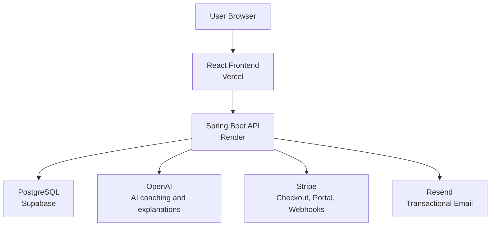

# TradePilot

## AI-Powered Trading Performance Coach

TradePilot helps futures traders discover costly habits, analyze their execution, and improve consistency using AI-driven coaching and behavioral analytics.

Built for traders who want more than a journal, TradePilot turns imported trade history into performance reports, coaching feedback, risk insights, and measurable improvement plans.

**Key highlights**

- AI Leak Detector
- Trading DNA
- Daily & Weekly AI Coach
- AI Trade Review
- Performance Analytics
- Risk & Behavioral Insights

## Screenshots

Screenshots will be added as the beta UI is finalized.

| Dashboard Command Center | AI Leak Detector Performance Report |
| --- | --- |
| `docs/screenshots/dashboard-command-center.png` | `docs/screenshots/ai-leak-detector-report.png` |

| Trading DNA | Daily Coach | Analytics |
| --- | --- | --- |
| `docs/screenshots/trading-dna.png` | `docs/screenshots/daily-coach.png` | `docs/screenshots/analytics.png` |

## Product Features

| Feature | Description |
| --- | --- |
| AI Leak Detector | Finds recurring habits costing traders money and generates a 30-day recovery plan. |
| Trading DNA | Builds a long-term profile of strengths, weaknesses, and behavioral patterns. |
| Daily Coach | Provides personalized daily preparation, risks to watch, and trading focus. |
| Weekly Coach | Reviews weekly performance and improvement areas. |
| AI Trade Review | Analyzes individual trades with execution feedback. |
| Session Review | Reviews complete trading sessions and patterns. |
| Advanced Analytics | Analyze performance by setup, day, session, confidence, and behavior. |
| Trade Calendar | Visualize historical trading performance. |
| CSV Import | Import Tradovate and other broker trade history. |
| Multi Account Support | Manage multiple prop and live trading accounts. |

## AI Leak Detector

The AI Leak Detector is TradePilot's flagship performance report. It identifies the behaviors and trading conditions most likely to be draining consistency, then turns those findings into a focused recovery plan.

**Performance Leak Report capabilities**

- Deterministic trade analysis
- Confidence scoring
- Monthly money impact calculations
- Potential yearly improvement
- Data quality scoring
- Related trade investigation
- AI-generated coaching explanations
- 30-day recovery plans

AI does not invent statistics. TradePilot calculates real metrics from trade history first, then uses AI to explain the findings in practical coaching language.

## Technology Stack

| Layer | Technology |
| --- | --- |
| Frontend | React, TypeScript, Vite, React Router, Tailwind CSS |
| Backend | Java 17, Spring Boot 3.3.5, Spring Security, JPA/Hibernate |
| Database | PostgreSQL via Supabase |
| Infrastructure | Vercel frontend hosting, Render backend hosting, Supabase PostgreSQL |
| Integrations | Stripe billing, Resend email, OpenAI |

## Architecture Overview



## Security & Reliability

TradePilot is built with production SaaS controls in mind:

- JWT authentication for protected API access
- Spring Security route protection
- Role-based admin access
- Backend feature access enforcement
- Monthly AI credit limits by plan
- Rate limiting for sensitive flows where implemented
- Async AI and email processing
- Cached AI results to reduce latency, cost, and duplicate credit usage
- Stripe webhook signature verification
- User ownership checks for user-scoped resources

Never commit `.env` files or real secrets. Production secrets belong in Render, Vercel, Supabase, Stripe, Resend, and OpenAI configuration surfaces.

## Subscription Model

| Plan | Included |
| --- | --- |
| Free | Dashboard, Calendar, Basic Analytics, 10 AI credits/month |
| Pro - $29.99/month | AI Leak Detector, Trading DNA, Daily Coach, Weekly Coach, Session Review, Advanced Analytics, 100 AI credits/month |

Cached AI results do not consume credits. Regeneration or force refresh consumes credits according to the feature cost.

## Documentation

- [Production Checklist](docs/PRODUCTION_CHECKLIST.md)
- [Environment Variables](docs/ENVIRONMENT_VARIABLES.md)
- [Database Migration Order](docs/DB_MIGRATION_ORDER.md)
- [Deployment Notes](docs/DEPLOYMENT_NOTES.md)
- [Safe Test Data Cleanup SQL](docs/SAFE_TEST_DATA_CLEANUP.sql)

## Local Development

### Prerequisites

- Java 17
- Node.js
- Maven
- PostgreSQL or Supabase Postgres for local database-backed development

### Backend

Configure backend environment variables outside Git. See [Environment Variables](docs/ENVIRONMENT_VARIABLES.md) for the complete production list.

```bash
cd backend
mvn spring-boot:run
```

The backend runs on:

```text
http://localhost:8080
```

### Frontend

Set the frontend API base URL:

```env
VITE_API_BASE_URL=http://localhost:8080/api
```

Run the app:

```bash
cd frontend
npm install
npm run dev
```

The frontend runs on:

```text
http://localhost:5173
```

## Testing

Backend:

```bash
cd backend
mvn clean test
```

Frontend:

```bash
cd frontend
npm run build
```

The backend includes extensive automated coverage, currently 90+ tests, including:

- Feature gating
- AI credit logic
- Security and data isolation
- Leak detection calculations
- Stripe billing and webhook behavior
- Admin and observability flows

## Version 1.1 - AI Trading Performance Coach

Recent V1.1 improvements:

- Released AI Leak Detector
- Added confidence scoring
- Added monthly and yearly impact analysis
- Added 30-day recovery plans
- Improved Daily Coach integration
- Added AI credit-aware caching
- Improved premium Pro feature UX
- Removed runtime dependence on Lombok builder classes in sensitive DTO paths

## Future Roadmap

| Near Term | Future |
| --- | --- |
| Dashboard V2 Trading Command Center | Trading Discipline Score |
| Production observability with Sentry | Historical improvement tracking |
| Performance optimization | Monthly performance reports |
|  | PDF exports |
|  | More broker integrations |

## Code Quality Notes

TradePilot follows production-oriented engineering practices:

- Test-driven fixes for billing, AI, analytics, and security flows
- Production-grade error handling for user-facing requests
- Database migrations for schema changes
- DTO stability without runtime Lombok builder dependencies in critical paths
- Clear separation between deterministic analytics and AI explanations
- Backend enforcement for subscription features and AI credit usage

## Deployment

Recommended beta deployment:

- Frontend: Vercel
- Backend: Render
- Database: Supabase PostgreSQL

Deployment essentials:

- Configure `VITE_API_BASE_URL` in Vercel.
- Configure backend secrets in Render.
- Set `APP_ALLOWED_ORIGINS` to the deployed frontend origin.
- Apply Supabase migrations in the documented order.
- Configure Stripe webhooks to point at `/api/stripe/webhook`.
- Configure Resend for verification, password reset, contact, and admin reply emails.
- Keep admin bootstrap opt-in and disable it after the first admin is promoted.

## Contributing

TradePilot is currently a private beta project. Future contributor guidelines will be added as the product moves toward a broader release.

## License

MIT License

## Author

Built by Atish Shrestha.
