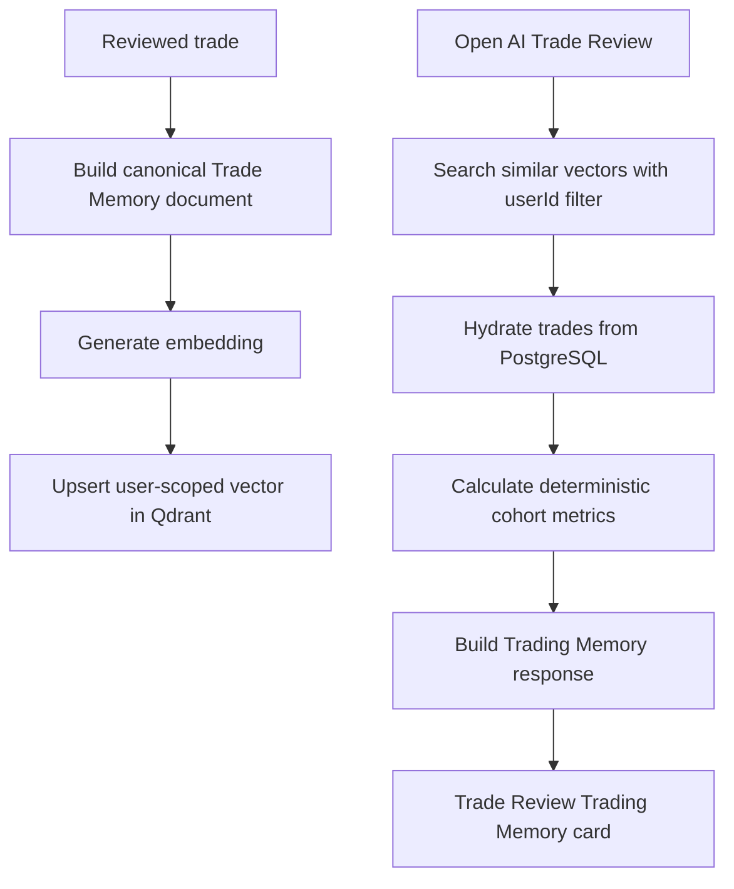

# AI Trading Memory

AI Trading Memory is a V2 feature that adds historical context to reviewed trades. It answers:

> Have I made this type of trade or mistake before, and what happened in those previous trades?

## Architecture

PostgreSQL remains the source of truth for trade facts and measurable statistics. Qdrant stores vectors only for semantic retrieval. The LLM explains verified results; it does not calculate counts, averages, R-multiples, MAE, MFE, or recurring-pattern metrics.



## Data Flow

1. AI Trade Review completes.
2. TradePilot builds a canonical memory document from available trade fields and review text.
3. The document hash and memory version are compared to the existing row.
4. If unchanged, indexing is skipped.
5. If changed, an embedding is generated and upserted to Qdrant.
6. The PostgreSQL `trade_memories` row is marked `INDEXED`, `FAILED`, `PENDING`, or `STALE`.
7. Similar-trade retrieval searches Qdrant with a mandatory `userId` filter.
8. Candidate trade IDs are batch-hydrated from PostgreSQL using the authenticated user ID.
9. Metrics and recurring patterns are calculated deterministically from hydrated data.

Indexing requests created during an active database transaction are deferred until transaction commit. Embedding and Qdrant calls must not run inside the AI Trade Review save transaction. If no active transaction exists, indexing still runs through the bounded async executor after the saved review call has returned.

## PostgreSQL Responsibilities

- Trade ownership and authoritative trade data
- Memory metadata and indexing status
- Content hash and memory version
- Normalized setup, emotion, and mistake labels
- Deterministic metrics from hydrated similar trades
- Backfill eligibility and idempotency

## Qdrant Responsibilities

- Vector storage
- Semantic similarity retrieval
- User-scoped point payload filtering

Qdrant is not statistical evidence. Similarity scores are used only to form a comparable cohort.

## Environment Variables

Backend:

```bash
V2_FEATURES_ENABLED=true
QDRANT_URL=https://your-qdrant-cluster
QDRANT_API_KEY=replace_with_secret
QDRANT_COLLECTION=tradepilot_trade_memories
OPENAI_API_KEY=replace_with_secret
```

Frontend:

```bash
VITE_V2_FEATURES_ENABLED=true
```

Spring properties:

```yaml
tradepilot:
  trading-memory:
    enabled: ${TRADING_MEMORY_ENABLED:true}
    collection-name: ${QDRANT_COLLECTION:${QDRANT_COLLECTION_NAME:tradepilot_trade_memories}}
    vector-size: ${TRADING_MEMORY_VECTOR_SIZE:1536}
    similarity-threshold: ${TRADING_MEMORY_SIMILARITY_THRESHOLD:0.72}
    default-limit: ${TRADING_MEMORY_DEFAULT_LIMIT:5}
    max-limit: ${TRADING_MEMORY_MAX_LIMIT:10}
    min-pattern-sample: ${TRADING_MEMORY_MIN_PATTERN_SAMPLE:5}
    min-pattern-occurrences: ${TRADING_MEMORY_MIN_PATTERN_OCCURRENCES:3}
    request-timeout-ms: ${TRADING_MEMORY_REQUEST_TIMEOUT_MS:3000}
    qdrant-auto-create-collection: ${TRADING_MEMORY_QDRANT_AUTO_CREATE_COLLECTION:true}
    qdrant-validate-on-startup: ${TRADING_MEMORY_QDRANT_VALIDATE_ON_STARTUP:true}
    qdrant-expected-distance: ${TRADING_MEMORY_QDRANT_EXPECTED_DISTANCE:COSINE}
    qdrant-create-payload-indexes: ${TRADING_MEMORY_QDRANT_CREATE_PAYLOAD_INDEXES:true}
    retry-enabled: ${TRADING_MEMORY_RETRY_ENABLED:false}
    retry-max-attempts: ${TRADING_MEMORY_RETRY_MAX_ATTEMPTS:5}
    retry-initial-delay-seconds: ${TRADING_MEMORY_RETRY_INITIAL_DELAY_SECONDS:60}
    retry-max-delay-seconds: ${TRADING_MEMORY_RETRY_MAX_DELAY_SECONDS:3600}
    retry-batch-size: ${TRADING_MEMORY_RETRY_BATCH_SIZE:50}
```

## Qdrant Validation

Trading Memory validates Qdrant without failing Spring Boot startup. Validation checks:

- Qdrant reachability
- Collection existence
- Configured vector size
- Expected distance metric, default `COSINE`
- Required payload-index availability where supported

If the collection is missing and `TRADING_MEMORY_QDRANT_AUTO_CREATE_COLLECTION=true`, TradePilot creates it and attempts to create payload indexes for:

`userId`, `accountId`, `tradeId`, `instrument`, `direction`, `setup`, `mistake`, `emotion`, `session`, `tradeDate`, `memoryVersion`

If an existing collection has the wrong vector size or distance metric, TradePilot does not delete or recreate it. Trading Memory returns an unavailable operational state while normal AI Trade Review continues.

## Collection Payload

Each Qdrant point payload includes:

- `tradeId`
- `userId`
- `accountId`
- `instrument`
- `direction`
- `setup`
- `mistake`
- `emotion`
- `session`
- `tradeDate`
- `memoryVersion`

Raw vectors are never exposed through public APIs.

## API Endpoints

User endpoints:

- `GET /api/v1/trades/{tradeId}/trading-memory`
- `POST /api/v1/trades/{tradeId}/trading-memory/regenerate`
- `GET /api/v1/trades/{tradeId}/similar-trades`

Legacy-compatible aliases are also mounted under `/api/trades/{tradeId}`.

Admin endpoint:

- `POST /api/v1/admin/trading-memory/backfill`
- `GET /api/v1/admin/trading-memory/health`
- `POST /api/v1/admin/trading-memory/retry-failed`
- `POST /api/v1/admin/trading-memory/retry/{tradeMemoryId}`

Example backfill request:

```json
{
  "dryRun": true,
  "limit": 100,
  "onlyReviewedTrades": true
}
```

## Retry Policy

Failed memory rows store sanitized retry metadata:

- `attempt_count`
- `last_attempted_at`
- `next_retry_at`
- `last_error_code`
- `last_error_message`

Supported error categories:

- `QDRANT_UNAVAILABLE`
- `QDRANT_CONFIGURATION_INVALID`
- `EMBEDDING_PROVIDER_UNAVAILABLE`
- `EMBEDDING_AUTHENTICATION_FAILED`
- `EMBEDDING_DIMENSION_MISMATCH`
- `TIMEOUT`
- `RATE_LIMITED`
- `UNKNOWN`

Temporary network, timeout, rate-limit, and provider-unavailable failures are retryable. Invalid credentials, dimension mismatch, and incompatible collection configuration are not automatically retried. Retry delay uses bounded exponential backoff.

Bulk retry supports dry-run mode:

```json
{
  "dryRun": true,
  "limit": 100,
  "errorCodes": ["QDRANT_UNAVAILABLE", "TIMEOUT"]
}
```

## Recurring Pattern Rules

The MVP detects a primary recurring mistake when:

- Similar cohort size is at least `min-pattern-sample`
- The same normalized mistake occurs at least `min-pattern-occurrences`
- Occurrence rate is at least 60%

Supported initial mistake categories:

- `CUT_WINNER_EARLY`
- `REVENGE_TRADE`
- `FOMO_ENTRY`
- `OVERTRADING`
- `MOVED_STOP`
- `IGNORED_BIAS`
- `OVERSIZED_POSITION`
- `TRADED_OUTSIDE_SESSION`

For `CUT_WINNER_EARLY`, opportunity R is calculated only when realized R and MFE R are both available.

## Security

- V2 routes are disabled when `V2_FEATURES_ENABLED=false`.
- Similarity search always includes Qdrant payload filters for authenticated `userId` and, when the trade belongs to an account, that `accountId`.
- Qdrant search always excludes the current trade ID via `must_not`.
- Optional setup, instrument, direction, and lookback filters are passed into the vector search request when supplied and enforced again after PostgreSQL hydration.
- PostgreSQL hydration always uses authenticated `userId` and account scope when available.
- Qdrant point IDs are internal.
- Full memory documents, trader notes, and emotional notes are not logged.
- Trading Memory failures do not block the existing AI Trade Review.

## Failure Handling

- Qdrant unavailable: returns `NOT_AVAILABLE`; AI Trade Review still works.
- Embedding provider unavailable: memory is marked `FAILED`; retry/regenerate remains possible.
- Missing or deleted Qdrant trade result: excluded during PostgreSQL hydration.
- AI insight unavailable: deterministic metrics and similar trades remain usable.
- Telemetry failures are fail-open and do not break Trading Memory responses.

## Deletion and Stale Handling

- Trade deletion deletes the PostgreSQL memory row and attempts to delete the Qdrant point.
- Account deletion deletes account-scoped PostgreSQL memory rows and attempts to delete account-scoped Qdrant points before removing the account's trades.
- Qdrant delete failures are logged and do not block core trade deletion.
- User-level memory deletion is user-scoped and uses Qdrant payload filtering by `userId`.
- Admin trade cleanup deletes matching memory rows and attempts vector deletion before batch-deleting trades.
- Trade edits mark existing memory `STALE`; regenerate/retry rebuilds the canonical document and compares the content hash.
- Deleted or inaccessible Qdrant candidates are removed during PostgreSQL hydration and never shown to the user.

## Insight Source Semantics

The response includes `aiInsight.source`:

- `DETERMINISTIC`: backend-generated summary from verified metrics.
- `AI`: LLM-generated explanation from verified metrics.
- `NONE`: no insight text is available.

The frontend labels deterministic text as `Pattern Summary`, not `AI Memory Insight`.

## Null Metric Behavior

MAE, MFE, exit efficiency, and opportunity metrics are shown only when authoritative source data exists. Missing values are omitted instead of displayed as zero.

## Similarity Evaluation

Normal tests use mock-mode fixtures and do not require Qdrant or OpenAI. The fixture covers categories such as IFVG continuation early exit, revenge trades, FOMO entries, moved stops, ignored bias, oversized position, rule-following winners, and overtrading.

Tune these settings only after reviewing evaluation output:

- `TRADING_MEMORY_SIMILARITY_THRESHOLD`
- `TRADING_MEMORY_DEFAULT_LIMIT`
- `TRADING_MEMORY_MAX_LIMIT`
- canonical memory-document wording
- optional metadata filters

Live evaluation should be run only with explicit credentials and a dedicated test collection. Do not run live evaluation in normal CI.

## Operational Checklist

- [ ] V2 enabled
- [ ] Trading Memory enabled
- [ ] Qdrant reachable
- [ ] Collection validated
- [ ] Vector dimensions match
- [ ] Cosine distance configured
- [ ] `userId` payload filter verified
- [ ] Backfill dry run completed
- [ ] Failed count reviewed
- [ ] Similarity evaluation completed
- [ ] Frontend null metrics verified
- [ ] Rollback flags tested

## Rollback

1. Set `V2_FEATURES_ENABLED=false`.
2. Set `TRADING_MEMORY_ENABLED=false` if a feature-specific shutdown is needed.
3. Restart backend and redeploy frontend with `VITE_V2_FEATURES_ENABLED=false`.
4. New indexing stops and the frontend card disappears.
5. Keep existing `trade_memories` rows and Qdrant collection intact.
6. V1 AI Trade Review behavior remains unchanged.

No rollback requires dropping the PostgreSQL table or Qdrant collection.

## Testing

Backend:

```bash
cd backend
mvn clean test
```

Frontend:

```bash
cd frontend
npm run build
```

Focused deterministic backend coverage is in `TradingMemoryDeterministicTests`.
